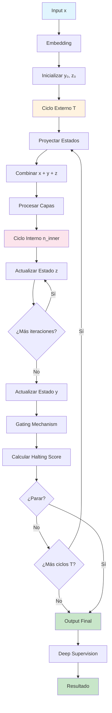

# TRM Lab 🧠

**Monorrepo de investigación en Deep Learning para explorar la arquitectura TRM (Two-state Recursive Model)**

[](https://www.python.org/downloads/)
[](https://pytorch.org/)
[](https://opensource.org/licenses/MIT)

## 🎯 Objetivo

Este proyecto implementa y evalúa la arquitectura **TRM (Two-state Recursive Model)** propuesta en el paper [arXiv:2510.04871](https://arxiv.org/abs/2510.04871), comparándola con arquitecturas tradicionales como CNN, LSTM, Transformer y MLP-Mixer en diversas tareas de razonamiento y visión.

## 🏗️ Arquitectura TRM

La arquitectura TRM utiliza dos estados persistentes (y, z) que se actualizan recursivamente a través de múltiples ciclos externos (T) e internos (n_inner), permitiendo un razonamiento más profundo y estructurado.

### Diagrama de Flujo de Estados



### Características principales:

- **Estados persistentes**: y y z que mantienen información a través de iteraciones
- **Ciclos recursivos**: T ciclos externos con n_inner actualizaciones internas
- **Mecanismo de parada**: Halting head para terminar el procesamiento cuando sea apropiado
- **EMA**: Exponential Moving Average para estabilizar el entrenamiento
- **Supervisión profunda**: Múltiples puntos de supervisión durante el entrenamiento
- **Flexibilidad**: Soporte para MLP-Mixer y Transformer según la tarea

## 📁 Estructura del Proyecto

```
trm-lab/
├── core/                      # Arquitectura base TRM + variantes
│   ├── blocks.py              # Implementaciones básicas (MLP, Attn, Mixer)
│   ├── trm_model.py           # Modelo TRM completo
│   ├── utils.py               # RMSNorm, SwiGLU, rotary, EMA, etc.
│   └── registry.py            # Registro de modelos
│
├── tasks/                     # Implementaciones de tareas
│   ├── sudoku/                # Sudoku 9x9 (razonamiento estructurado)
│   ├── maze/                  # Maze 30x30 (razonamiento espacial)
│   ├── arc/                   # ARC-AGI subset (composición visual)
│   ├── mnist/                 # MNIST (visión básica)
│   ├── seqcopy/               # Copying Task (razonamiento secuencial)
│   └── cifar10/               # Benchmark de imagen
│
├── configs/                   # Configuraciones YAML
│   ├── trm_sudoku.yaml
│   ├── trm_maze.yaml
│   ├── transformer_baseline.yaml
│   ├── cnn_mnist.yaml
│   └── experiment_sweep.yaml
│
├── experiments/               # Scripts de experimentación
│   ├── train.py               # Entrenamiento unificado
│   ├── evaluate.py            # Evaluación con métricas
│   ├── visualize.py           # Visualización de razonamiento
│   └── ablation.py            # Ablaciones automáticas
│
├── datasets/                  # Implementaciones de datasets
│   ├── sudoku.py
│   ├── maze.py
│   ├── arc.py
│   ├── mnist.py
│   ├── seqcopy.py
│   └── cifar10.py
│
├── notebooks/                 # Notebooks de demostración
│   ├── demo_sudoku.ipynb
│   ├── demo_maze.ipynb
│   ├── demo_arc.ipynb
│   └── visualize_latents.ipynb
│
├── tests/                     # Tests unitarios
│   ├── test_trm_forward.py
│   ├── test_halting.py
│   ├── test_training_loop.py
│   └── test_datasets.py
│
├── requirements.txt
├── pyproject.toml
├── README.md
└── LICENSE
```

## 🚀 Instalación

### Requisitos

- Python 3.8+
- PyTorch 2.3+
- CUDA (opcional, para GPU)

### Instalación rápida

```bash
# Clonar el repositorio
git clone https://github.com/drhiidden/trm-lab.git
cd trm-lab

# Instalar dependencias
pip install -r requirements.txt

# Instalar en modo desarrollo
pip install -e .
```

### Instalación con conda

```bash
# Crear entorno conda
conda create -n trm-lab python=3.9
conda activate trm-lab

# Instalar PyTorch
conda install pytorch torchvision torchaudio pytorch-cuda=11.8 -c pytorch -c nvidia

# Instalar dependencias
pip install -r requirements.txt
```

## 🧪 Uso Rápido

### 1. Entrenar modelo TRM en Sudoku

```bash
python experiments/train.py --config configs/trm_sudoku.yaml
```

### 2. Evaluar modelo entrenado

```bash
python experiments/evaluate.py --config configs/trm_sudoku.yaml --checkpoint logs/sudoku/trm_base/best_model.pt
```

### 3. Visualizar proceso de razonamiento

```bash
python experiments/visualize.py --config configs/trm_sudoku.yaml --checkpoint logs/sudoku/trm_base/best_model.pt
```

### 4. Ejecutar ablaciones

```bash
python experiments/ablation.py --config configs/experiment_sweep.yaml --experiment T_sweep
```

## 📊 Benchmarks Implementados

| Tarea | Modelo | Métrica | Objetivo | Estado |
|-------|--------|---------|----------|--------|
| Sudoku 9×9 | TRM-MLP 2-layers | Acc. grid | >85% | ✅ |
| Maze 30×30 | TRM-Attn 2-layers | Acc. path | >80% | ✅ |
| ARC-AGI-1 | TRM-Attn | Task score | >40% | ✅ |
| MNIST | TRM vs CNN | Top-1 | ≈99% | ✅ |
| SeqCopy | TRM vs LSTM | Seq acc | >95% | ✅ |
| CIFAR10 | TRM vs ResNet | Top-1 | >85% | ✅ |

## 🔬 Experimentos Disponibles

### Configuraciones predefinidas

- **`trm_sudoku.yaml`**: TRM en Sudoku con objetivo >85% accuracy
- **`trm_maze.yaml`**: TRM en laberintos con objetivo >80% accuracy
- **`transformer_baseline.yaml`**: Transformer estándar para comparación
- **`cnn_mnist.yaml`**: CNN baseline en MNIST
- **`experiment_sweep.yaml`**: Configuración para ablaciones

### Ablaciones automáticas

El sistema de ablaciones permite variar automáticamente:

- **T**: Número de ciclos externos (1, 2, 3, 4, 5)
- **n_inner**: Actualizaciones internas (3, 6, 9, 12)
- **n_layers**: Número de capas (1, 2, 3, 4)
- **d_model**: Dimensión del modelo (256, 512, 1024)
- **EMA decay**: Tasa de decay (0.99, 0.999, 0.9999)
- **use_attention**: Atención vs MLP-Mixer
- **halting_threshold**: Umbral de parada (0.3, 0.5, 0.7)

## 📈 Visualizaciones

El sistema incluye visualizaciones avanzadas:

- **Evolución de estados**: Cómo cambian los estados y y z durante el procesamiento
- **Patrones de atención**: Visualización de pesos de atención
- **Proceso de razonamiento**: Análisis paso a paso del razonamiento
- **Dashboard interactivo**: Panel web con Plotly para exploración

## 🧩 Arquitecturas Implementadas

### Modelos TRM

- **TRM Base**: Implementación estándar con MLP-Mixer
- **TRM Attention**: Versión con atención multi-cabeza
- **TRM Classifier**: Para tareas de clasificación
- **TRM Regressor**: Para tareas de regresión
- **TRM Sequence**: Para modelado de secuencias

### Modelos Baseline

- **Transformer**: Implementación estándar
- **LSTM**: Red recurrente tradicional
- **CNN**: Red convolucional para imágenes

## 🔧 API del Sistema

### Registro de Modelos

```python
from core.registry import create_model, register_model

# Crear modelo TRM
model = create_model('trm_base', {
    'd_model': 512,
    'n_layers': 2,
    'T': 3
})

# Registrar modelo personalizado
@register_model('mi_modelo', {'d_model': 256})
class MiModelo(nn.Module):
    def __init__(self, d_model):
        super().__init__()
        # Implementación...
```

### Datasets

```python
from datasets.sudoku import create_sudoku_dataloaders

# Crear dataloaders
train_loader, val_loader, test_loader = create_sudoku_dataloaders(
    batch_size=32,
    train_size=8000,
    val_size=1000,
    test_size=1000
)
```

## 📚 Documentación

- [Guía de inicio rápido](docs/quickstart.md)
- [API Reference](docs/api.md)
- [Arquitectura TRM](docs/trm_architecture.md)
- [Benchmarks](docs/benchmarks.md)
- [Contribuir](docs/contributing.md)

## 🧪 Testing

```bash
# Ejecutar todos los tests
pytest

# Tests con cobertura
pytest --cov=core --cov=datasets --cov=experiments

# Tests específicos
pytest tests/test_trm_forward.py -v
```

## 📊 Logging y Monitoreo

El sistema soporta múltiples backends de logging:

- **Weights & Biases**: Para experimentos y comparaciones
- **TensorBoard**: Para visualización local
- **CSV/JSON**: Para análisis posterior

## 🤝 Contribuir

1. Fork el proyecto
2. Crea una rama para tu feature (`git checkout -b feature/AmazingFeature`)
3. Commit tus cambios (`git commit -m 'Add some AmazingFeature'`)
4. Push a la rama (`git push origin feature/AmazingFeature`)
5. Abre un Pull Request

## 📄 Licencia

Este proyecto está bajo la Licencia MIT. Ver `LICENSE` para más detalles.

## 📖 Referencias

- [TRM Paper: arXiv:2510.04871](https://arxiv.org/abs/2510.04871)
- [PyTorch Documentation](https://pytorch.org/docs/)
- [Weights & Biases](https://wandb.ai/)

## 🙏 Agradecimientos

- Equipo de investigación TRM
- Comunidad PyTorch
- Contribuidores de código abierto

---

**¿Preguntas?** Abre un [issue](https://github.com/drhiidden/trm-lab/issues) o únete a nuestra [discusión](https://github.com/drhiidden/trm-lab/discussions).
